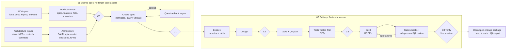

# Product Canvas: idea to OpenSpec change to live, tested prototype, on Mistral

**Live demo:** _link added after first deploy_ · **MCP tool:** `<space-url>/gradio_api/mcp/`

One shared spec, then delivery. A product owner gives an idea (plus briefs, Figma exports or answers), an
architect gives intent, NFRs, controls or API contracts, and optionally an existing prototype. A team of
Mistral agents turns that into an approved **OpenSpec change** and then a **working app with its tests
running inside it**. A human approves every step.

I built this to practise deploying an agentic workflow end to end the way it would run at a customer:
one source of truth for requirements, guardrails that stop agents guessing, tests before code, an
independent reviewer, evidence before release, and a package that drops straight into a repo.

## The flow



| Stage | What happens | Built on |
|---|---|---|
| Inputs and guardrails | PO inputs, architecture inputs and target code are kept apart. Limits, moderation, uploaded text treated as data | `mistral-moderation-latest`, `mistral-ocr-latest` for PDFs, `mistral-medium-latest` vision for designs |
| Product canvas + architecture [C0] | Epics, features, acceptance criteria, test scenarios and clarifying questions; a nodes and relationships model in the style of FINOS CALM, with decisions and measurable NFRs | `mistral-large-latest`, structured outputs |
| Shared spec [C1] | Normalise, clarify, validate into an OpenSpec change: proposal plus one spec per capability, SHALL requirements, WHEN/THEN scenarios. Conflicts come back as questions and block approval | OpenSpec format, `mistral-embed` flags duplicate requirements |
| Explore + design [C2] | First access to target code; it informs delivery but can never change requirements | explore.md, design.md |
| Tasks + tests [C3] | tasks.md checklist and a QA plan covering every scenario; executable tests are written before any code | `codestral-latest` |
| Build + verify [C4] | Code model builds a single file app; static checks and an independent reviewer (a different model) trace each scenario to code; failures are triaged to app, test or spec owners; app failures are fixed and re-checked; the app runs live with its tests in the page | `codestral-latest`, `mistral-medium-latest` as reviewer |
| Package | `openspec/changes/<id>/` (proposal, specs, design, tasks, explore), CALM JSON, Jira CSV, app, tests, QA report | |

**Validation at every checkpoint (no model needed):** SHALL or MUST in every requirement, at least one WHEN/THEN
scenario each, kebab-case names; every canvas feature and NFR traced into the spec; every requirement to a
task; every scenario to a test; the app is self contained and every test id exists in the code.

**Agent design.** Each agent's instructions live in [`skills/`](skills/) as `SKILL.md` files in the open Agent
Skills format, so behaviour can be read and changed without touching Python. The flow follows the patterns in
Anthropic's [Building effective agents](https://www.anthropic.com/engineering/building-effective-agents):
prompt chaining with gates between steps, routing work to the right model, and an evaluator and optimiser
loop for the build.

## Measuring it

`python -m evals.run_evals` runs the whole flow on six ideas (one deliberately vague) and writes a scorecard:
spec errors, conflicts raised, plan coverage, static errors, scenarios passing on the first build and after
fixes, fix rounds, seconds and cost. Run it before and after changing a skill or a model.

## Run it locally

```bash
pip install -r requirements-dev.txt
export MISTRAL_API_KEY=...        # free key from console.mistral.ai; without it the app runs in demo mode
python app.py                     # http://127.0.0.1:7860
pytest -q                         # offline tests, no key needed
```

## Deploy

A Hugging Face Space on the free CPU tier. Every push to `main` runs the tests and mirrors the repo to the Space
([`.github/workflows/deploy.yml`](.github/workflows/deploy.yml)). The Mistral key lives only in the Space's secrets.

## Use it from Le Chat, Claude or any MCP client

The spec stage is exposed as one MCP tool, `idea_to_openspec`. Add `<space-url>/gradio_api/mcp/` as a custom
connector and ask for a spec in chat.

## Project layout

```
app.py                 Gradio UI, checkpoints C0 to C4, MCP tool
skills/*/SKILL.md      instructions for each agent (Agent Skills format)
canvas/
  schemas.py           output contract for every artefact
  agents.py            loads skills and calls the right model for each agent
  pipeline.py          the stages and the build, review, fix loop
  evals.py             OpenSpec validation, traceability, static build checks
  harness.py           the browser test harness injected into the live preview
  exporters.py         OpenSpec files, CALM JSON, Jira CSV, package zip
  guardrails.py        limits, moderation, prompt injection hygiene
  ingest.py            text, Word, HTML, PDF (OCR) and image (vision) inputs
  llm.py               the only module that calls Mistral; retries, telemetry, demo fake
evals/                 golden ideas and scorecard runner
docs/                  deployment playbook and learning guide
```

## Not in scope yet

- Archiving a delivered change into living capability specs (OpenSpec's archive step).
- Delivering to several real repositories (frontend, API, database) from one shared spec.
- Pushing tasks to Jira through its API, and grounding specs in a customer's existing docs.

Built by [Siddharth Narayanan](https://www.linkedin.com/in/siddharth-narayanan-80364a108/) with AI pair programming.
