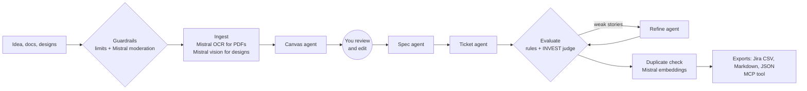

# Product Canvas: idea to spec to Jira backlog, on Mistral

**Live demo:** _link added after first deploy_ · **Use it from Le Chat or Claude:** MCP endpoint at `<space-url>/gradio_api/mcp/`

Give it a one line idea, a brief (PDF, Word, Markdown), an HTML prototype or a design screenshot.
A small team of Mistral agents drafts a **product canvas** for you to approve, then a **spec** and a
**Jira ready backlog**. The agents check their own work, fix weak stories, and report what the run cost
and what it saved.

I built this to practise deploying an agentic workflow end to end the way it would run at a customer:
grounded inputs, guardrails, a human checkpoint, evaluation, observability, a business case, and a
hand off into the tools the team already uses.

## What happens when you click run



| Stage | What it does | Mistral capability |
|---|---|---|
| Guardrails | File limits, harmful content blocked, personal data flagged, uploaded text treated as data not instructions | `mistral-moderation-latest` |
| Ingest | PDFs keep headings and tables; design screenshots become a written description of screens and flows; HTML and Word are parsed directly | `mistral-ocr-latest`, `mistral-medium-latest` (vision) |
| Canvas, spec, tickets | Three agents, each with one job and a strict output contract | `mistral-large-latest` with structured outputs (JSON schema) |
| Human in the loop | The canvas is shown for review and can be edited before any detailed work starts | |
| Evaluation | Rule checks (story format, Given/When/Then criteria, Fibonacci points, every Must and Should requirement covered) plus an LLM judge scoring INVEST | `mistral-small-latest` as judge |
| Self correction | Only stories that fail go to a refine agent, then get re-scored | `mistral-large-latest` |
| Duplicate check | Flags near identical stories by cosine similarity | `mistral-embed` |
| Observability | Every call logged with model, latency, tokens and estimated cost | |
| Value | Estimated manual effort replaced versus model cost, with assumptions shown | |
| Hand off | Jira CSV import (epics linked to stories), Markdown for Confluence or Notion, JSON, and an MCP tool | |

**Model routing.** The strongest model writes, a small fast model judges, and specialist models do OCR,
vision, embeddings and moderation. Each is set in [`canvas/config.py`](canvas/config.py) and can be
swapped with an environment variable, so cost and quality can be tuned per customer.

## Measuring quality

`python -m evals.run_evals` runs the full workflow on a fixed set of six ideas (including a deliberately
vague one) and writes a scorecard: final quality score, lift from the refine step, rule pass rate, judge
score, uncovered requirements, duplicates, seconds and cost per run. Run it before and after changing a
prompt or a model. The live scorecard is in [`evals/results/scorecard.md`](evals/results/) once generated.

## Run it locally

```bash
pip install -r requirements-dev.txt
export MISTRAL_API_KEY=...        # free key from console.mistral.ai; without it the app runs in demo mode
python app.py                     # http://127.0.0.1:7860
pytest -q                         # offline tests, no key needed
```

## Deploy

The app is a Hugging Face Space (free CPU tier). Pushing to `main` runs the tests and mirrors the repo
to the Space through [`.github/workflows/deploy.yml`](.github/workflows/deploy.yml). The Mistral key
lives only in the Space's secrets.

## Use it as a tool from Le Chat, Claude or any MCP client

The workflow is exposed as one MCP tool, `idea_to_backlog`. Add `<space-url>/gradio_api/mcp/` as a
custom connector and ask for a backlog in chat.

## Project layout

```
app.py                  Gradio UI and MCP tool
canvas/
  schemas.py            output contracts for every agent
  agents.py             prompts and the four agents
  pipeline.py           the two stage workflow and refine loop
  evals.py              rule checks, judge scoring, duplicate detection
  guardrails.py         limits, moderation, prompt injection hygiene
  ingest.py             text, Word, HTML, PDF (OCR) and image (vision) inputs
  llm.py                the only module that calls Mistral; retries, telemetry, demo fake
  telemetry.py          run log and cost estimate
  exporters.py          Jira CSV, Markdown, JSON
evals/                  golden set and scorecard runner
docs/
  DEPLOYMENT_PLAYBOOK.md  how I would pilot and scale this with a customer
  LEARNING_GUIDE.md       the design decisions, explained
```

## Next steps

- Push tickets straight into Jira through its API instead of CSV.
- Ground specs in a customer's existing docs with a document library (retrieval) step.
- Swap to a self deployed open weights model for customers who need data to stay on premises.

Built by [Siddharth Narayanan](https://www.linkedin.com/in/siddharth-narayanan-80364a108/) with AI pair programming.
